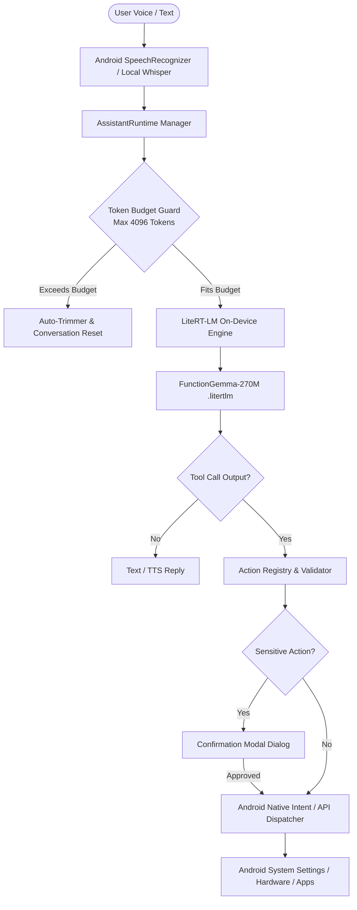

# Mobile-Actions: Fine-Tuned FunctionGemma-270M On-Device Assistant for Android

[](https://kotlinlang.org)
[](https://developer.android.com)
[](https://ai.google.dev/edge/litert)
[](https://huggingface.co/google/gemma-2-2b)
[](LICENSE)

An on-device, local-first voice assistant and mobile action execution engine for Android, powered by a fine-tuned **FunctionGemma-270M** model (`functiongemma_mobile_actions.litertlm`, ~435 MB).

The system executes native Android tasks locally on-device without cloud API dependencies, featuring a bounded token budget manager (4,096 tokens), bilingual speech recognition (English + Telugu), confirmation barriers for sensitive actions, and an action registry.

---

## Architecture Overview



---

## Key Features

1. **On-Device Inference**:
   - Runs locally on Android device hardware (CPU/GPU/NPU) using Google LiteRT-LM runtime.
   - Zero cloud inference costs, zero data leakage, and offline availability.

2. **Context Budget Management**:
   - Strictly enforces the 4,096 token limit for the 270M model.
   - Employs an active catalog of 38 executable native tool schemas (~2,400 tokens), leaving >1,000 tokens for dynamic user conversation history.
   - Bounded turn history (retaining the most recent 3 turns) and automatic engine session recreation when encountering native engine exceptions (`state: 7`).

3. **Bilingual Speech Interface**:
   - Supports **English (India)** (`en-IN`) and **Telugu (India)** (`te-IN`).
   - Prioritizes on-device `SpeechRecognizer` with automatic fallback to system speech services.
   - Android `TextToSpeech` with Telugu Unicode range detection.

4. **Security & Human-in-the-Loop Safeguards**:
   - Safe tools (Flashlight, Settings toggles, Map queries, Battery status, Timers) execute with immediate user feedback.
   - Sensitive tools (Contact creation, Calendar modifications, Email/SMS composition, Phone dialing) require explicit user confirmation before opening system intents.
   - Strict input validation prevents non-HTTPS URL schemes, shell command injections, and malformed parameters.

---

## Executable Action Tools (38 Handlers)

| Category | Example Handlers |
| :--- | :--- |
| **Hardware** | `turn_on_flashlight`, `turn_off_flashlight`, `toggle_flashlight` |
| **Settings** | `open_wifi_settings`, `open_bluetooth_pairing`, `open_battery_saver_settings`, `open_system_settings`, `open_storage_settings`, `open_developer_options`, `open_airplane_mode_settings` |
| **Navigation & Search** | `show_location_on_map`, `navigate_to_place`, `search_web`, `open_url` |
| **Apps & Launcher** | `open_app`, `go_home_screen` |
| **Clock & Timers** | `create_alarm`, `create_timer`, `open_clock_stopwatch` |
| **Telemetry & System** | `get_battery_status`, `get_device_info`, `check_current_time_date`, `copy_to_clipboard` |
| **Media & Capture** | `take_photo`, `open_video_camera`, `open_photo_gallery` |
| **Communication (Confirmation Required)** | `create_contact`, `dial_phone_number`, `send_email`, `compose_email`, `compose_sms`, `create_calendar_event` |

---

## Directory Structure

```
.
├── README.md
├── mobile_actions_v1.ipynb              # Model fine-tuning notebook & evaluation
├── docs/
│   └── screen_preview.png              # Android live running screenshot
└── android_app/                        # Standalone Android Studio project
    ├── build.gradle.kts
    ├── settings.gradle.kts
    └── app/
        ├── build.gradle.kts
        └── src/
            ├── main/
            │   ├── AndroidManifest.xml
            │   ├── assets/
            │   │   ├── tool_catalog_active.json   # 38 Executable tools catalog
            │   │   └── tool_catalog.json          # 108 Full specification catalog
            │   └── java/com/example/functiongemmavoice/
            │       ├── MainActivity.kt            # Jetpack Compose UI & Voice pipeline
            │       ├── runtime/
            │       │   ├── ActionRegistry.kt      # Validation & Native execution
            │       │   └── AssistantRuntime.kt    # LiteRT-LM & Budget management
            │       └── speech/
            │           └── WhisperTinyFallback.kt # Offline whisper fallback structure
            └── test/
                └── java/com/example/functiongemmavoice/
                    └── ActionRegistryTest.kt      # Unit tests (100% pass)
```

---

## Building and Running

### Prerequisites
- Android Studio Ladybug / Meerkat or newer
- JDK 17 / 21
- Android device running Android 14+ (Targeted for Android 16, `arm64-v8a`)
- `functiongemma_mobile_actions.litertlm` placed in app storage or selected via the built-in document picker.

### Steps
1. Clone the repository:
   ```bash
   git clone https://github.com/Viswanath129/Mobile-Actions.git
   cd Mobile-Actions/android_app
   ```
2. Build the debug APK:
   ```bash
   ./gradlew assembleDebug
   ```
3. Install to your connected device:
   ```bash
   adb install -r app/build/outputs/apk/debug/app-debug.apk
   ```
4. Push the model directly to the app directory:
   ```bash
   adb push functiongemma_mobile_actions.litertlm /sdcard/Android/data/com.example.functiongemmavoice/files/
   ```
5. Launch the application from your launcher or via ADB:
   ```bash
   adb shell am start -n com.example.functiongemmavoice/.MainActivity
   ```